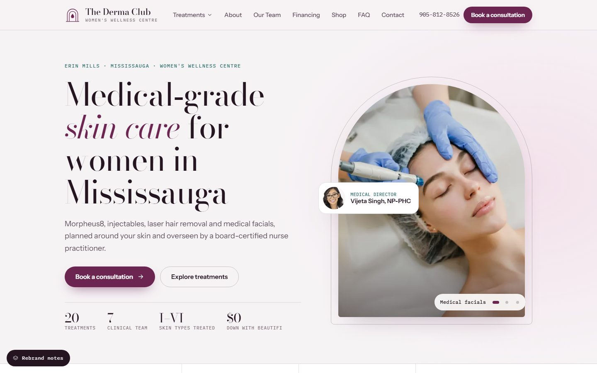
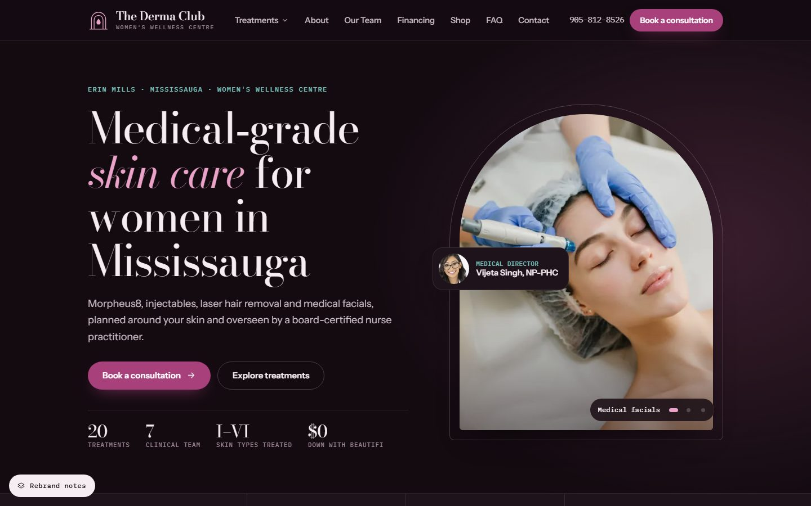
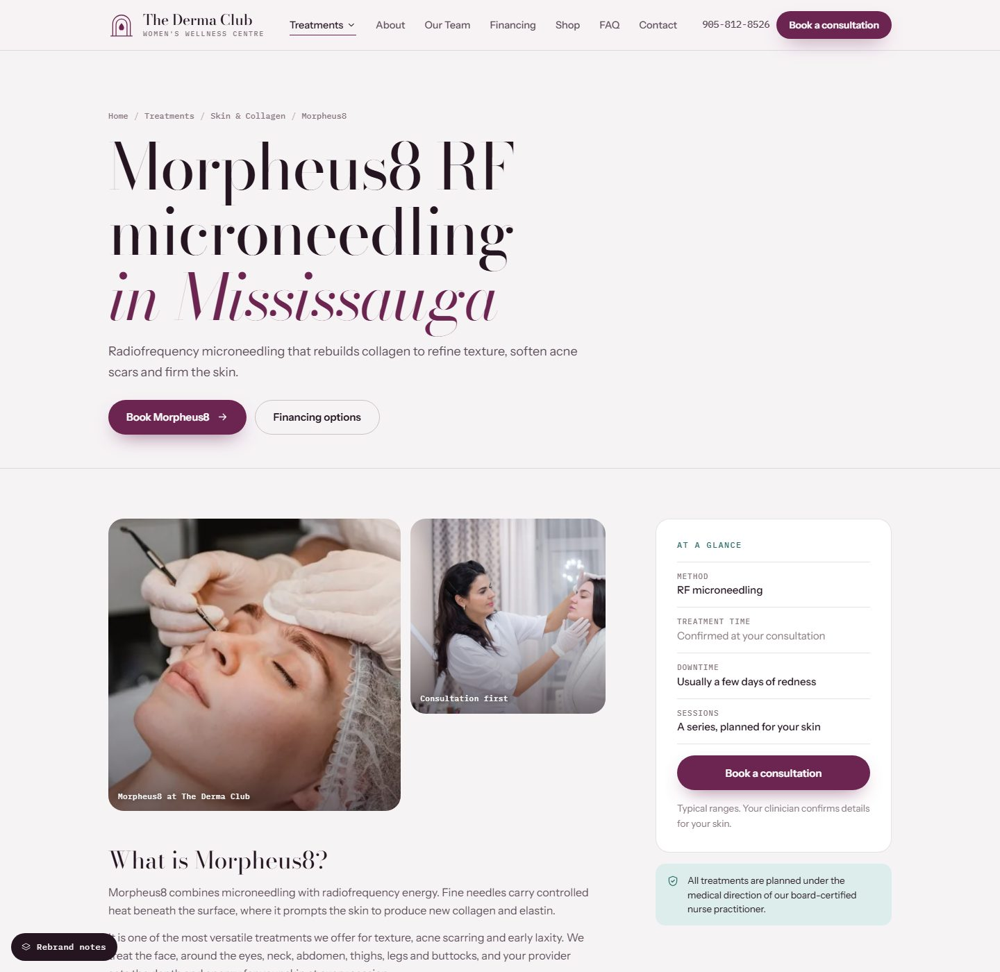
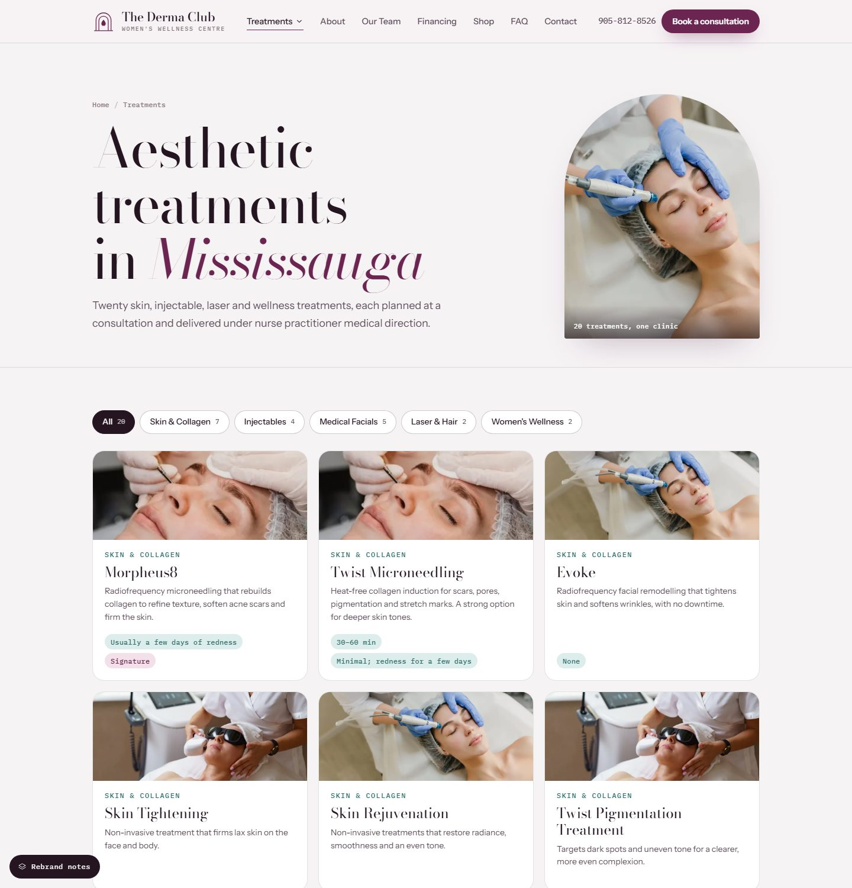
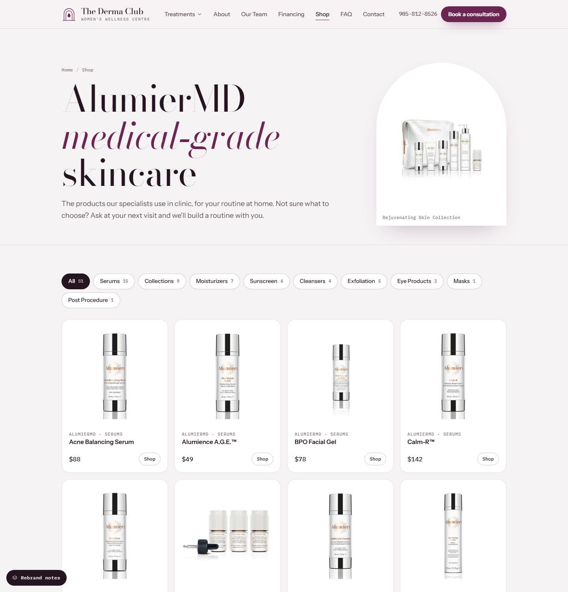
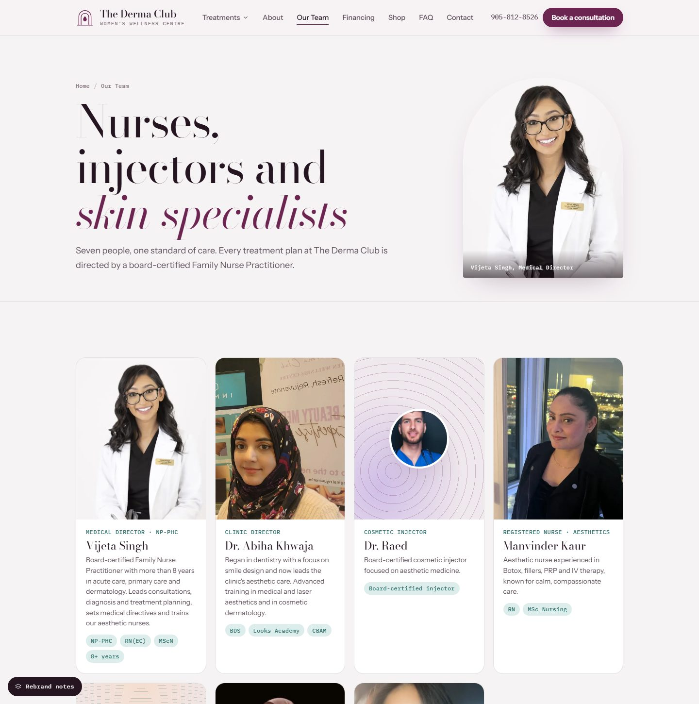
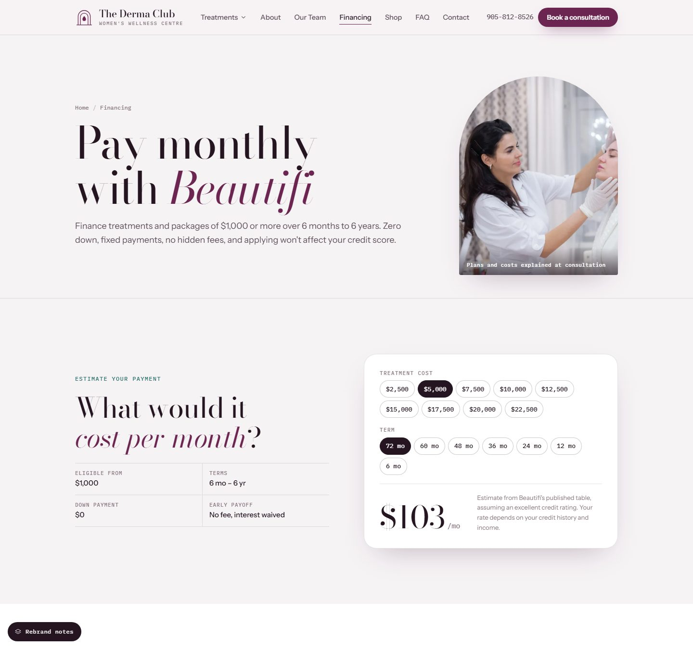
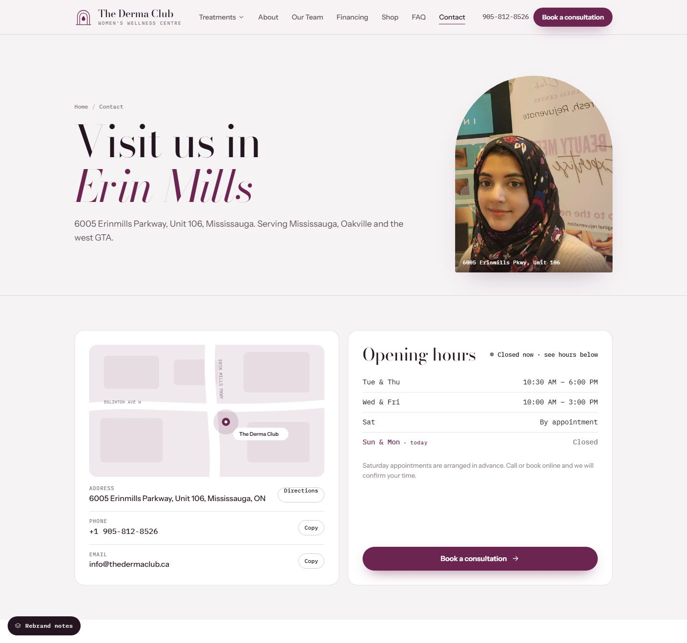
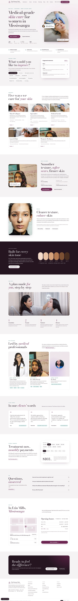

# The Derma Club — website rebrand

Redesigned website for **The Derma Club & Women's Wellness Centre**, 6005 Erinmills Parkway, Unit 106, Mississauga.

It's a static site with no framework and no npm dependencies. A small Node script prerenders every page to plain HTML for search engines. In the browser, the same templates handle navigation, the treatment finder, the booking drawer, the Beautifi calculator and the shop filters.

- 30 pages: home, 20 treatment pages, treatments hub, about, team, financing, shop, FAQ, contact, rebrand notes and a 404 page
- Unique title, meta description, canonical URL and Open Graph tags on every page
- `MedicalClinic` structured data on every page. Treatment pages add `MedicalProcedure`, `BreadcrumbList` and `FAQPage`
- 301 redirects from the old WordPress URLs (`/service/morpheus-8` → `/treatments/morpheus8` and so on), set in `vercel.json`
- `sitemap.xml` and `robots.txt` are generated at build time
- Light and dark themes, responsive down to 360px

## Screenshots



<table>
  <tr>
    <td width="50%"><br><sub><b>Home, dark theme.</b> Follows the visitor's system setting, with a manual switch in the footer.</sub></td>
    <td width="50%"><br><sub><b>Treatment page.</b> Clinic photos, an "at a glance" summary, visit steps and FAQs for each of the 20 treatments.</sub></td>
  </tr>
  <tr>
    <td width="50%"><br><sub><b>Treatments.</b> All 20 treatments, filterable by category, plus a treatment finder by concern.</sub></td>
    <td width="50%"><br><sub><b>Shop.</b> 51 AlumierMD products with real photos and prices, across 9 categories.</sub></td>
  </tr>
  <tr>
    <td width="50%"><br><sub><b>Our team.</b> Portraits, roles and credentials, led by the Medical Director.</sub></td>
    <td width="50%"><br><sub><b>Financing.</b> Monthly payment calculator built from Beautifi's published rate table.</sub></td>
  </tr>
  <tr>
    <td width="50%"><br><sub><b>Contact.</b> Address, live open/closed status in Toronto time, hours and a contact form.</sub></td>
    <td width="50%" align="center"><br><sub><b>Mobile.</b> Every page is responsive down to 360px.</sub></td>
  </tr>
</table>

<details>
<summary><b>Full home page</b> (click to expand)</summary>



</details>

To refresh the screenshots after design changes, run `npm run dev` and capture each page at 1440px wide. Save them over the files in `docs/screenshots/`.

## Project structure

```
src/
  app.js        Content (treatments, team, FAQs, products, Beautifi table), page templates and browser behaviour
  styles.css    All styles; design tokens are at the top
  shell.html    Header, menu, footer, booking drawer and icon sprite shared by every page
public/         Copied as-is: media/, og/, favicons
docs/           README screenshots (not deployed)
scripts/
  build.mjs     Prerenders every route into dist/
  serve.mjs     Local preview server with the same clean URLs as Vercel
vercel.json     Build settings, redirects, caching and security headers
```

## Run locally

Requires Node 18 or newer.

```bash
npm run dev
```

Then open http://localhost:3000.

## Deploy to Vercel through GitHub

1. Create an empty repository on GitHub, for example `dermaclub-rebrand`.
2. Push this folder:
   ```bash
   git remote add origin https://github.com/<your-account>/dermaclub-rebrand.git
   git push -u origin main
   ```
3. In Vercel, choose **Add New → Project**, import the repository and click **Deploy**. `vercel.json` already sets the build command (`npm run build`) and the output directory (`dist`), so leave the framework preset as **Other**.

Every push to `main` deploys to production. Pull requests get preview URLs.

## Environment variables

| Variable | Default | Purpose |
|---|---|---|
| `SITE_INDEXABLE` | not set | Leave unset while the clinic reviews the design. Pages carry `noindex` and `robots.txt` blocks crawlers. Set to `true` on the go-live deploy: pages become indexable, the sitemap is listed and the Rebrand notes page and button are removed. |
| `SITE_URL` | Vercel production domain, otherwise `https://thedermaclub.ca` | Used for canonical links, Open Graph URLs and the sitemap. Set it to `https://thedermaclub.ca` when the domain is connected. |

## Editing content

All copy and data live at the top of `src/app.js`:

- `T`: the 20 treatments (name, H1, summary, description, concerns, time, downtime, sessions)
- `TEAM`, `QUOTES`, `FAQS`, `HOURS`
- `FIN_AMT`, `FIN_TERM`, `FIN`: Beautifi's published monthly payment table
- `PRODUCTS`: the 51 AlumierMD products (name, category, price, image)
- `SEO`: title tags and meta descriptions for the main pages. Treatment titles are generated from each treatment's H1.

Images go in `public/media/` and are referenced as `/media/<file>.webp`. Run `npm run dev` to check changes.

## Before going live

- [ ] Clinic approves the design and copy
- [ ] Choose one booking system. "Book on Jane" links to `thedermaclub.janeapp.com`, and the booking drawer is a front-end prototype that should hand off to Jane's booking link.
- [ ] Connect the contact form to an email or form service (it currently validates and shows a confirmation only)
- [ ] Add the clinic's Beautifi application link and AlumierMD store links (buttons currently show a notice)
- [ ] Replace the stock treatment photos with the clinic photoshoot, and add portraits for Dr. Raed and Rutva
- [ ] Connect `thedermaclub.ca` in Vercel, set `SITE_URL` and `SITE_INDEXABLE=true`, and redeploy
- [ ] Submit `https://thedermaclub.ca/sitemap.xml` in Google Search Console
- [ ] Note: the old `/faq/` URL was the financing page. It now shows the real FAQ, which links to `/financing`.
